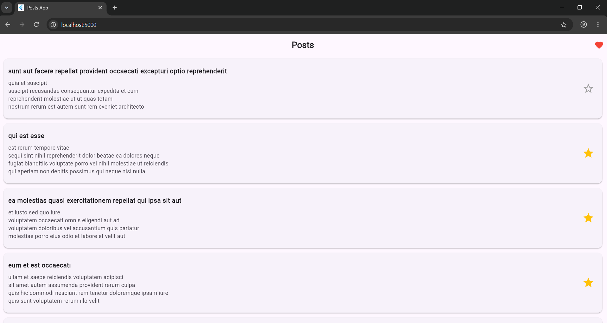
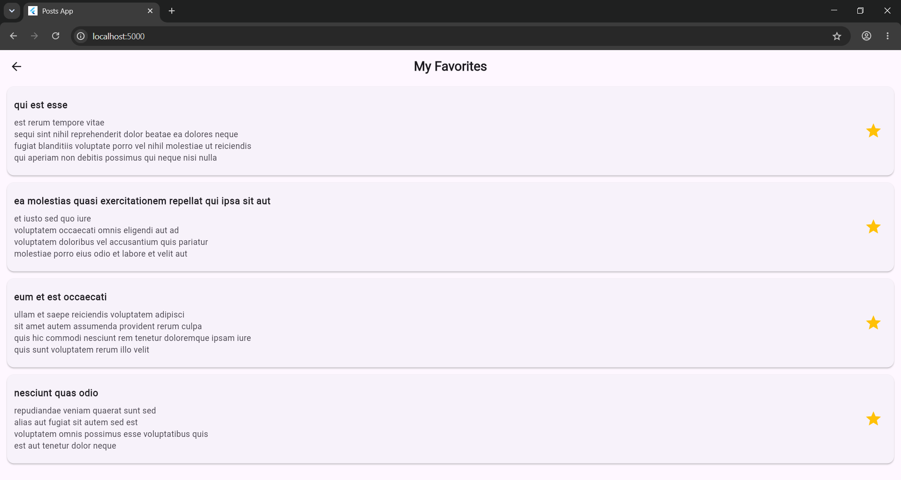
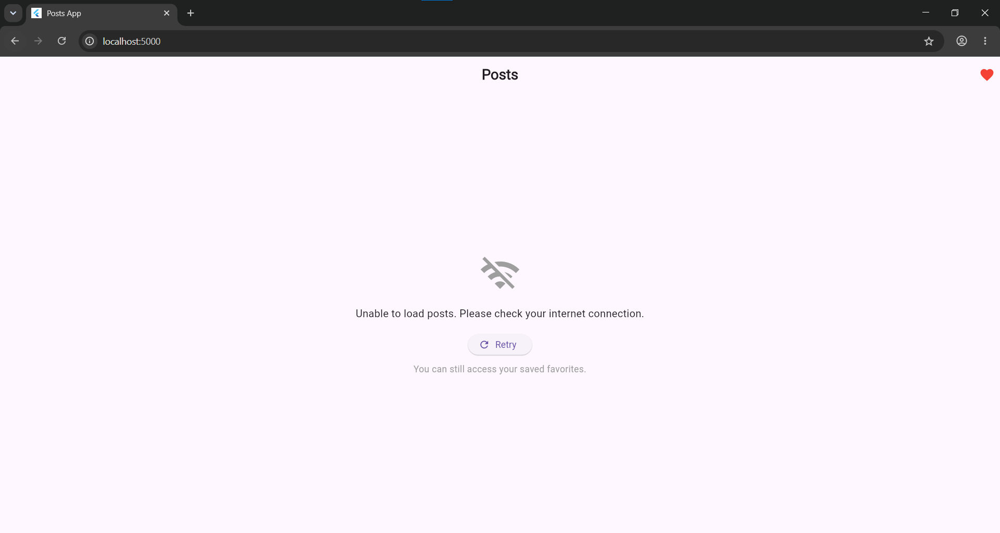
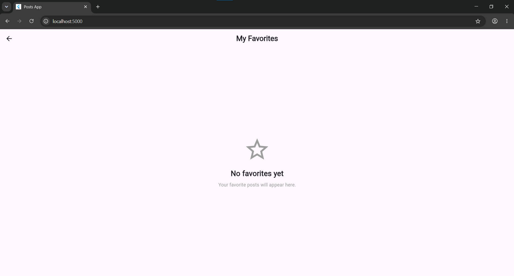

# Flutter Favorites App ⭐

## 📌 Project Overview

The **Flutter Favorites App** is a mobile/web application that displays posts retrieved from an online API and allows users to save their favorite posts locally using Hive Database.

Users can add or remove posts from their favorites list, view all saved favorites on a separate screen, and access previously saved favorites without an internet connection.

The application uses local storage to ensure that favorite posts remain saved even after refreshing or restarting the application.

## ✨ Features

### 1. Posts Screen
- Fetches posts from the JSONPlaceholder API.
- Displays posts using organized cards.
- Shows a filled star (`Icons.star`) for favorite posts.
- Shows an outlined star (`Icons.star_border`) for non-favorite posts.
- Allows users to add or remove posts from favorites.
- Updates favorite icons immediately when tapped.
- Displays cached posts when the API is unavailable.

### 2. Favorites Screen
- Displays all posts saved as favorites.
- Uses the same card design as the Posts Screen.
- Allows users to remove posts from favorites.
- Displays a friendly **"No favorites yet"** message when the favorites list is empty.
- Reads saved favorites directly from local Hive storage.

### 3. Local Data Persistence
- Uses Hive as a local NoSQL database.
- Stores favorites in a separate box named `favoritesBox`.
- Uses the post ID as the key for each favorite.
- Saves a copy of each post to avoid HiveObject conflicts.
- Preserves saved favorites across application restarts.

### 4. Offline Support
- Stores favorite posts locally using Hive.
- Allows previously saved favorites to be accessed without an internet connection.
- Keeps favorites independent of the online posts API.
- Uses locally cached posts when available if an API request fails.

## 🛠️ Technologies Used

- **Flutter:** Application development framework.
- **Dart:** Programming language.
- **Hive:** Local NoSQL database.
- **Hive Flutter:** Hive integration with Flutter.
- **HTTP:** Fetching posts from the online API.
- **JSONPlaceholder API:** Online source of posts.

## 📂 Project Structure

```text
favorites_app/
│
├── lib/
│   ├── main.dart
│   ├── models/
│   │   ├── post.dart
│   │   └── post.g.dart
│   ├── services/
│   │   ├── post_service.dart
│   │   └── favorites_service.dart
│   └── screens/
│       ├── posts_screen.dart
│       └── favorites_screen.dart
│
├── screenshots/
│   ├── posts_screen.png
│   ├── favorites_screen.png
│   ├── offline_test.png
│   └── empty_favourites.png
│
├── pubspec.yaml
├── pubspec.lock
└── README.md
```

## ⚙️ Installation and Setup

### Prerequisites

- Flutter SDK
- Dart SDK
- Visual Studio Code
- Chrome (if running the web version)

### 1. Clone the Repository

```bash
git clone https://github.com/mariam643/flutter-favorites-app.git
```

Navigate to the project directory:

```bash
cd flutter-favorites-app
```

### 2. Install Dependencies

```bash
flutter pub get
```

### 3. Install Hive Code Generation Dependencies

```bash
flutter pub add --dev build_runner hive_generator
```

These packages are required to generate the Hive Type Adapter.

### 4. Generate the Hive Adapter

```bash
dart run build_runner build --delete-conflicting-outputs
```

This generates the `post.g.dart` file based on the annotations in `post.dart`.

**Note:** The generated `post.g.dart` file should be included in the repository and should not be edited manually.

### 5. Run the Application

To run the application in Chrome:

```bash
flutter run -d chrome --web-port 5000
```

To run it on an available Android device:

```bash
flutter run
```

## 🗄️ Hive Database Configuration

The application uses two separate Hive boxes:

| Box Name | Purpose |
|---|---|
| `postsBox` | Stores locally cached posts. |
| `favoritesBox` | Stores posts marked as favorites. |

The `favoritesBox` uses the post ID as its key.

When a user adds a post to favorites, a separate copy of the post is stored in the favorites box.

When a user removes a favorite, its corresponding entry is deleted using its ID.

## 🌐 API Information

The application retrieves posts from:

**JSONPlaceholder API**

https://jsonplaceholder.typicode.com/posts

The API provides sample posts containing:

- Post ID
- User ID
- Title
- Body

The application can use previously cached posts when the API is unavailable.

## 🧪 Testing

The following scenarios should be tested:

1. Run the application with an internet connection.
2. Verify that posts are loaded successfully.
3. Add several posts to favorites.
4. Verify that the favorite icons change immediately.
5. Open the Favorites Screen and check the saved posts.
6. Remove a post from favorites.
7. Refresh the application and verify that favorites remain.
8. Close and reopen the application and verify persistence.
9. Enable Airplane Mode and check that previously saved favorites remain accessible.
10. Remove all favorites and verify that the empty-state message appears.

## 📸 Screenshots

Application screenshots are available in the `screenshots/` directory.

### 1. Posts Screen



### 2. Favorites Screen



### 3. Offline Support



### 4. Empty Favorites Screen



## 🎯 Project Objective

The main objective of this project is to implement a persistent favorites feature using Hive local storage in Flutter.

The project demonstrates:

- Local database operations.
- State management using `ValueListenableBuilder`.
- API integration.
- Hive Type Adapter generation.
- Offline access to locally saved data.
- Data persistence across application restarts.

## 📤 GitHub Repository

The project is available on GitHub:

**Repository:** https://github.com/mariam643/flutter-favorites-app

### Uploading the Project to GitHub (First Time)

After creating the GitHub repository, open the project folder in VS Code and run:

```bash
git init
git add .
git commit -m "Initial commit - Flutter Favorites App"
git branch -M main
git remote add origin https://github.com/mariam643/flutter-favorites-app.git
git push -u origin main
```

### If the Remote Repository Is Already Connected

If Git reports that `origin` already exists, update the existing remote URL instead of adding another one:

```bash
git remote set-url origin https://github.com/mariam643/flutter-favorites-app.git
```

Verify the remote:

```bash
git remote -v
```

Then push your changes:

```bash
git push -u origin main
```

**Note:** The `git init` and `git remote add origin` commands are only needed when setting up the repository for the first time.

---

**Developed using Flutter and Dart.**